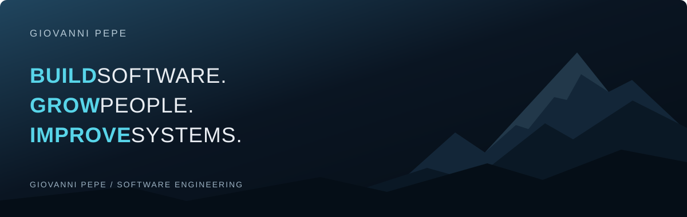

  

Sono un Tech Lead e lavoro nel punto d’incontro tra tecnologia, persone e delivery. Qui raccolgo progetti personali e sperimentazioni: backend, app Android e workflow per usare l’AI nello sviluppo software con ownership e capacità critica.

[LinkedIn](https://www.linkedin.com/in/giovanni-pepe-it/) · **Engineering Leadership · Software Architecture · AI**

### Progetti in evidenza

| Progetto | Cosa trovi |
| :--- | :--- |
| **[Codex Skills](https://github.com/giovanni-pepe/skills)** | Una raccolta di skill e workflow riutilizzabili per lo sviluppo con Codex. |
| **[Ultima Torcia Toolkit](https://github.com/giovanni-pepe/ultima-torcia-toolkit)** | Un compagno di gioco Android: schede personaggio, dadi e PDF, con dati in locale. |
| **[Entra TOTP Handler](https://github.com/giovanni-pepe/entra-totp-handler)** | Un PoC backend per la gestione di credenziali TOTP con Spring Boot. |

### Tra codice e sperimentazione

**Backend** · Java, Spring Boot, API REST  
**Mobile** · Kotlin, Jetpack Compose, Room  
**Workflow** · Skill, automazione e sviluppo assistito da AI

---

Hai un'idea o una miglioria per un progetto? Apri una issue o proponi una pull request nel repository.
